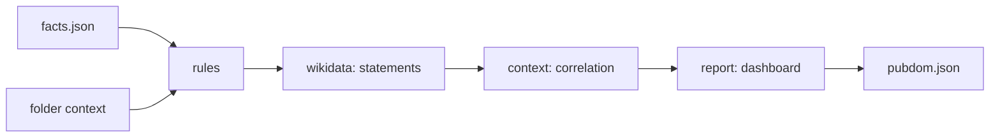

# pd_checker — internals del pacchetto

Pacchetto Python, file di catalogo e suite di test. La documentazione rivolta all'utente è nella radice del repository ([`../README.md`](../README.md)); il riferimento legale è in [`../publicdomain-checker.md`](../publicdomain-checker.md).

## Cosa fa il pacchetto

Legge una cartella di materiale scannerizzato, applica in modo deterministico le regole di copyright per Italia, Regno Unito e Vaticano, e prepara i metadati Commons e Wikidata necessari a pubblicare ciò che passa.

Non chiama mai un modello per decidere la legge, e non inventa mai un identificativo, un template di licenza o una categoria.

## Moduli

Sette moduli. I cinque moduli di libreria vivono in `core/`; `python3 -m pd_checker` è l'unica superficie di comando.

- `__init__.py` — superficie del pacchetto. riesporta `evaluate`, `evaluate_many`, le tre costanti di stato e `RULE_TABLE_VERSION`.
- `__main__.py` — l'unica riga di comando (12 sottocomandi), l'orchestrazione del pipeline e il cancello di preflight.
- `core/rules.py` — il valutatore deterministico: termini per paese più orchestrazione del motore. La sua docstring cita ogni fonte legale, articolo per articolo.
- `core/catalogs.py` — i quattro cataloghi Wikimedia e la verifica live via API, dietro un'unica costante `DATA_DIR`.
- `core/context.py` — contesto della cartella (provenienza, detentore dei diritti, paese, periodo), il suggerimento del paese da segnali di lingua e luogo, e la correlazione tra serie.
- `core/wikidata.py` — costruisce le dichiarazioni Wikidata, la lista delle categorie e il manifest di caricamento a partire da verdetti e contesto.
- `core/report.py` — genera la dashboard HTML statica di revisione (interfaccia in italiano, nessun JavaScript).
- `core/push.py` — l'invio a Commons via API: dry-run di default, credenziali solo da variabili d'ambiente, mai sovrascrive file esistenti.

## File di dati

- `data/commons_templates.json` — il catalogo Commons dei template di licenza scaricato: 1357 template con i loro metadati di categoria.
- `data/wikidata_entities.json` — le proprietà e gli elementi Wikidata che lo strumento può emettere, ciascuno verificato via API Wikidata.
- `data/wd_cache.json` — la cache nome→QID. È l'unica fonte dei QID. Un QID è l'identificativo numerico di un'entità Wikidata (es. `Q507540` è Rafael Merry del Val).
- `data/cat_cache.json` — le categorie Commons verificate finora.
- `SKILL.md` — come un agente pilota lo strumento: pipeline, controlli e comandi di convalida (in inglese, come tutta la documentazione per agenti).

I file di catalogo in `data/` sono dati di rilascio, non scratch: il pipeline e i test li trattano come sola lettura.

## Flusso dei dati



## Invarianti che il codice impone

- `rules.py` non chiama mai un modello. Fatti identici producono sempre lo stesso verdetto.
- Lo stato complessivo è `public_domain` solo se l'opera è di pubblico dominio nel suo paese d'origine **e** in Italia. Una valutazione `incerta` su un lato rende incerto lo stato complessivo.
- Solo un anno letto dall'elemento stesso (testo stampato, timbro postale) può decidere un confine. Qualsiasi altro anno è protetto dal margine.
- I blocchi non-copyright — diritti sul ritratto, consenso alla corrispondenza — sono indicati separatamente e non cambiano mai lo stato del copyright.
- Nessun template di licenza viene emesso mentre il verdetto è `incerto`.
- `wikidata.py` non emette mai un QID che non sia in `wd_cache.json`; un nome non risolto è marcato `da_rivedere`.
- Template, entità Wikidata e categorie sono convalidati su cataloghi reali. Uno mancante è segnalato sull'elemento, mai presupposto.

## Test

```bash
python3 -m pytest pd_checker/tests -q
```

La suite copre le tabelle regole, la logica delle giurisdizioni, il tetto del termine più breve, il ramo dei detentori aziendali, i margini sulle stime, la gestione del ruolo d'autore, le guardie sui cataloghi e la struttura della dashboard generata.
